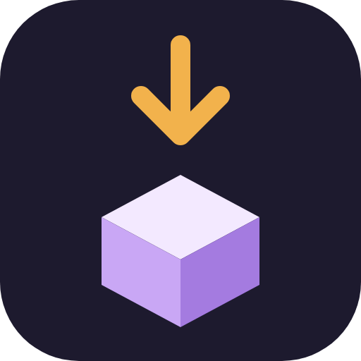
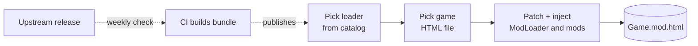

<div align="center">



# MIFS

**ModLoader Installer for SugarCube**

Add ModLoader and its standard mods to a SugarCube 2 game in a few clicks.<br/>
Your original game file is never touched.

[](https://github.com/LeafGithub/mifs/releases/latest)
[](https://github.com/LeafGithub/mifs/releases)
[](https://github.com/LeafGithub/mifs/releases/latest)
[](https://github.com/LeafGithub/mifs/stargazers)

[](https://github.com/LeafGithub/mifs/actions/workflows/build-app.yml)
[](https://github.com/LeafGithub/mifs/actions/workflows/check-upstream.yml)
[](LICENSE)

[](https://github.com/LeafGithub/mifs/commits)
[](https://ko-fi.com/V7V21QT2FO)

[**Download**](https://github.com/LeafGithub/mifs/releases/latest) · [Supported games](#supported-games) · [How it works](#how-it-works) · [Development](#development)

</div>

---

## Download

| | File | Notes |
|---|---|---|
| **Installer** | `MIFS-Setup-<version>.exe` | Per user, no admin rights needed |
| **Portable** | `MIFS-<version>-portable.exe` | Run from anywhere, nothing installed |

> [!NOTE]
> Builds are unsigned, so Windows SmartScreen warns on first run: choose **More info → Run anyway**.

MIFS updates itself when a new release is published.

## Features

- **Three-step wizard:** pick a loader, pick your game file, install.
- **Safe by design:** a new `.mod.html` is written next to your game; the original is never modified.
- **Always current:** a catalog of ready-made ModLoader bundles, rebuilt automatically when upstream publishes a new version.
- **Update detection:** MIFS tells you when a newer build with different content is available.
- **Themes:** Interstellar and Lilypad, with optional 3D backdrops.

## Supported games

| Game | Status |
|---|---|
| Degrees of Lewdity (vanilla) | Supported (compiled from source, needs Git) |
| Degrees of Lewdity Plus | Supported |
| DoL X-Change | Supported |
| More SugarCube 2 games | Planned |

MIFS only produces the modded HTML. Game images and audio are not handled; keep the resource folders next to the file, as the game already expects.

## How it works



## Activity

<a href="https://star-history.com/#LeafGithub/mifs&Date">
  <picture>
    <source media="(prefers-color-scheme: dark)" srcset="https://api.star-history.com/svg?repos=LeafGithub/mifs&type=Date&theme=dark" />
    
  </picture>
</a>


## Development

<details>
<summary><b>Repository layout</b></summary>

| Package | Contents |
|---|---|
| `packages/core` | Patch and inject logic, manifest parsing, dependency resolution. No runtime dependencies on Node or the browser. |
| `packages/ui` | React + Tailwind UI, the `Platform` interface it talks to, and a mock platform |
| `packages/desktop` | Electron app: main process services, sandboxed preload, installer packaging |
| `bundle/` | Scripts that build a loader bundle (`BeforeSC2.js`, mods, licenses, `manifest.json`) |

</details>

<details>
<summary><b>Commands</b></summary>

```bash
npm install
npm run dev          # Electron app with hot reload
npm run dev:ui       # UI in a browser against the mock platform (http://localhost:5199)
npm run typecheck
npm test             # core unit tests; conformance tests need ../modloader-lab built
npm run e2e          # drives the built Electron app; needs a bundle in bundle/dist
npm run dist -w @mifs/desktop   # installer + portable exe -> packages/desktop/release/
```

</details>

<details>
<summary><b>Bundles and the catalog (CI)</b></summary>

- **Build ModLoader bundle** (`build-bundle.yml`, manual): builds any ModLoader repo and ref, publishes it as a release (`loader-<id>`) and updates the `catalog` release. Forks are published as pre-releases.
- **Check upstream for new releases** (`check-upstream.yml`, Mondays 06:17 UTC or manual): builds official `x.y.z` tags newer than the newest published upstream bundle (at most 2 per run).
- **Notify on CI failure** (`notify-failure.yml`): opens a `ci-failure` issue when either workflow fails and closes it when the same job succeeds.
- **Mod list:** each ref is built with its own `modList.json`; `bundle/mods.json` is the fallback.

</details>

<details>
<summary><b>Packaging</b></summary>

- Output: `MIFS-Setup-<version>.exe` (NSIS) and `MIFS-<version>-portable.exe`.
- electron-vite bundles everything, so no `node_modules` ship. Electron is pinned to an exact version.
- User data (bundles, downloaded games, logs) is in `%APPDATA%\MIFS`.

</details>

## License

[PolyForm Noncommercial 1.0.0](LICENSE): free to use, modify and share for noncommercial purposes. Selling it or using it commercially needs the author's permission. ModLoader and the bundled mods keep their own licenses.

## Support

MIFS is free. If it is useful to you, you can support it on Ko-fi:

[](https://ko-fi.com/V7V21QT2FO)
